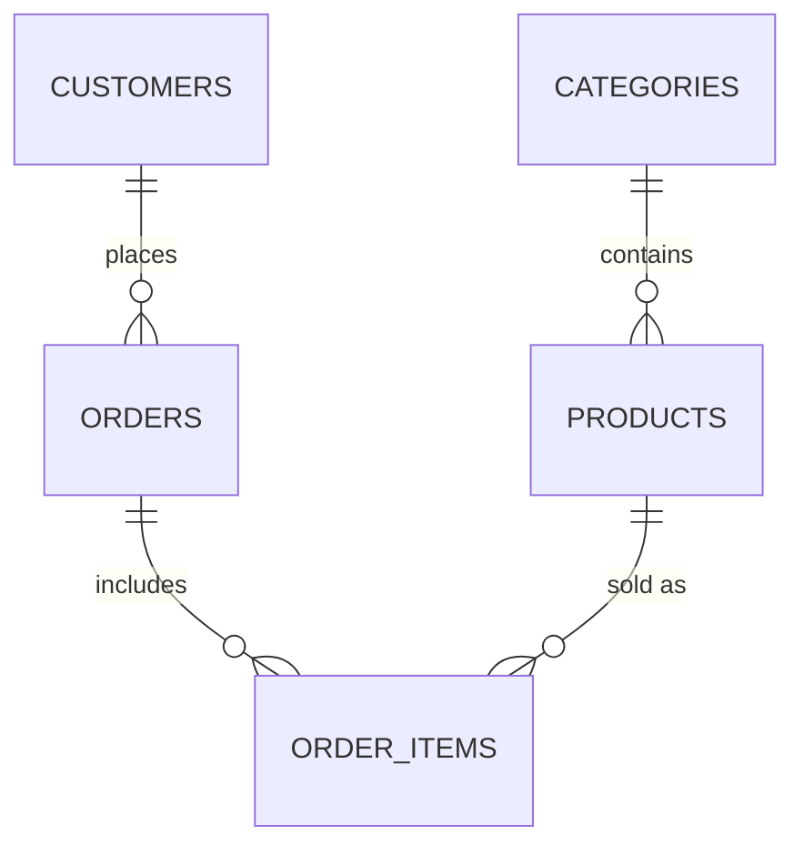

# 🛒 Retail Sales Analysis with SQL

> End-to-end SQL project: building a retail database, validating data quality, and turning raw orders into KPIs and business recommendations.

<p>     </p>

---

## 📌 Project Overview
A small online retailer wants to know **what sells, who buys, and where revenue is at risk**. I built the 5-table database from scratch, checked the data before trusting it, then answered business questions at three levels: stakeholder requests, KPIs, and customer/inventory insights.

## 🗂️ Data Model

| Table | Rows | Purpose |
|---|---|---|
| categories | 5 | Product groupings |
| customers | 11 | Name, city, state, signup date |
| products | 12 | Price and stock level |
| orders | 15 | Status: completed/returned / cancelled |
| order_items | 20 | Line items (quantity × unit price) |

**Business rule:** revenue counts `completed` orders only.

## 📁 Repository Structure
```
├── sql/
│   ├── 01_create_tables.sql        # schema + sample data
│   ├── 02_data_validation.sql      # row counts, orphan keys, duplicates, price & NULL checks
│   ├── 03_business_questions.sql   # 6 stakeholder requests
│   └── 04_kpi_analysis.sql         # 10 KPI / insight queries
├── docs/index.html                 # interactive dashboard + query explorer
└── README.md
```
**Run it:** paste the files into a Databricks SQL editor in order (01 → 04). Replace the `CREATE CATALOG` lines if your platform doesn't use catalogs.

## ✅ Data Validation (before any analysis)
Row counts match expectations; there are **no orphaned foreign keys**, **no duplicate order IDs**, and **every charged price equals the catalog price** (no hidden discounts). Status values are limited to the three expected ones.

## 📊 Key Findings
| Metric | Result |
|---|---|
| Completed orders | **12** of 15 (80%) |
| Revenue | **$1,779.74** |
| Average order value | **$148.31** |
| Top product by revenue | Stand Mixer: **$499.98** from only 2 units |
| Top product by volume | Mystery Novel: 5 units, only $74.95 |
| Best category | Home & Kitchen: $589.97 (33%) |
| Best state | Colorado: $549.96 |
| Monthly trend | Jan $514.93 → Feb −25.2% → Mar +45.5% → Apr −42.9% |
| Revenue lost | $399.97 in cancelled/returned orders (20% of orders) |
| Customers | 3 High · 2 Mid · 3 Low · 3 with no completed purchase |

## 💡 Recommendations
1. **Restock the Bluetooth Speaker.** It sold 2 units and now has 0 stock.
2. **Bundle low-price, high-volume items** (books, yoga mats) with premium goods to lift order value.
3. **Investigate the 20% cancel/return rate**, especially the $199.99 Espresso Machine return.
4. **Run a welcome offer for Zoe Patel**, who signed up but never ordered, and a win-back campaign for Emma and Sophia, whose only orders were cancelled/returned.
5. **Treat monthly trends cautiously.** With 12 orders, one big purchase swings growth by tens of percent.

## 🧠 SQL Concepts Demonstrated
`JOIN` / `LEFT JOIN` anti-joins · CTEs · `LAG()` and windowed `SUM() OVER()` · `CASE` · `GROUP BY` / `HAVING` · `DATE_TRUNC` · `COALESCE` · half-open date ranges · integrity checks


